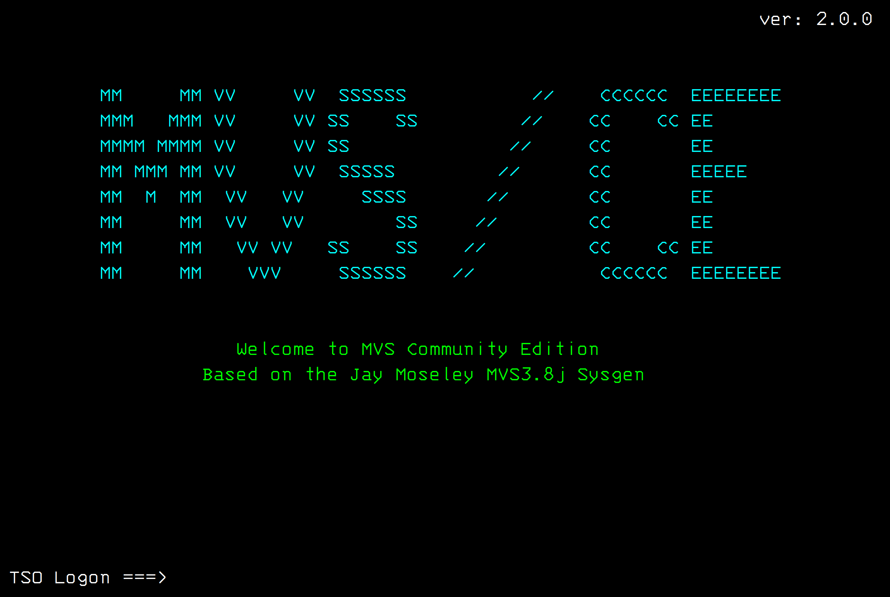
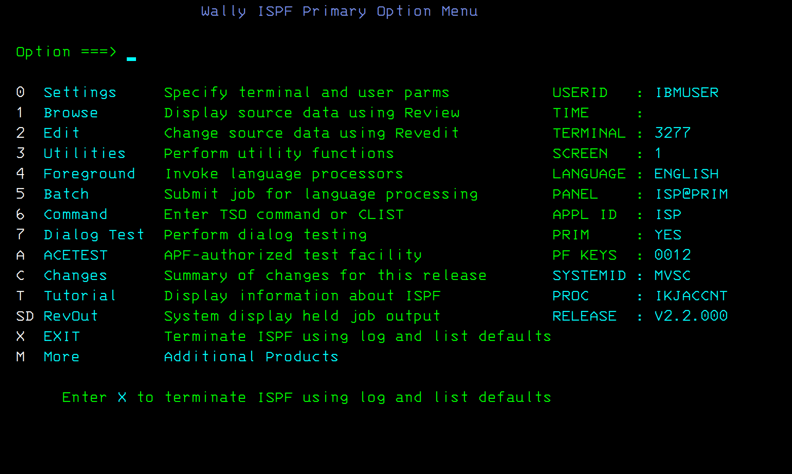
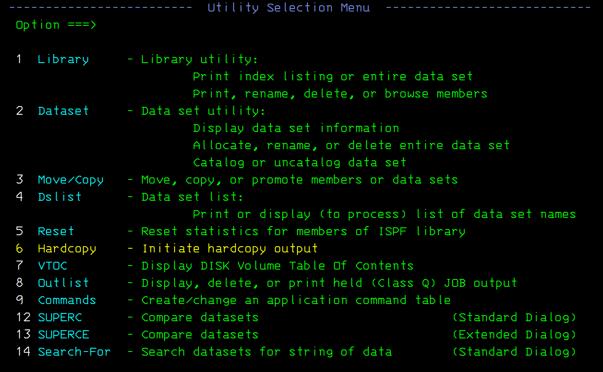
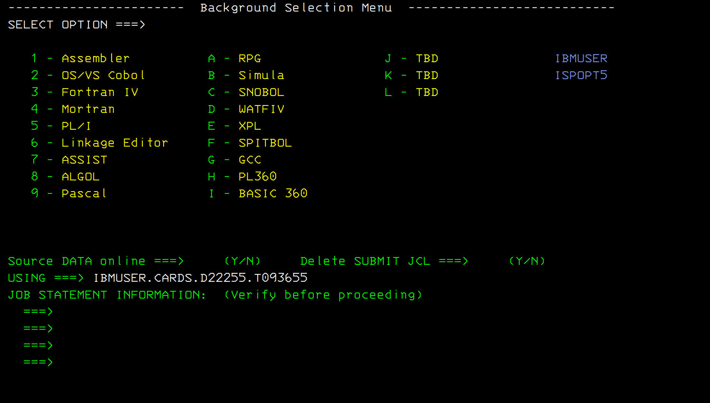
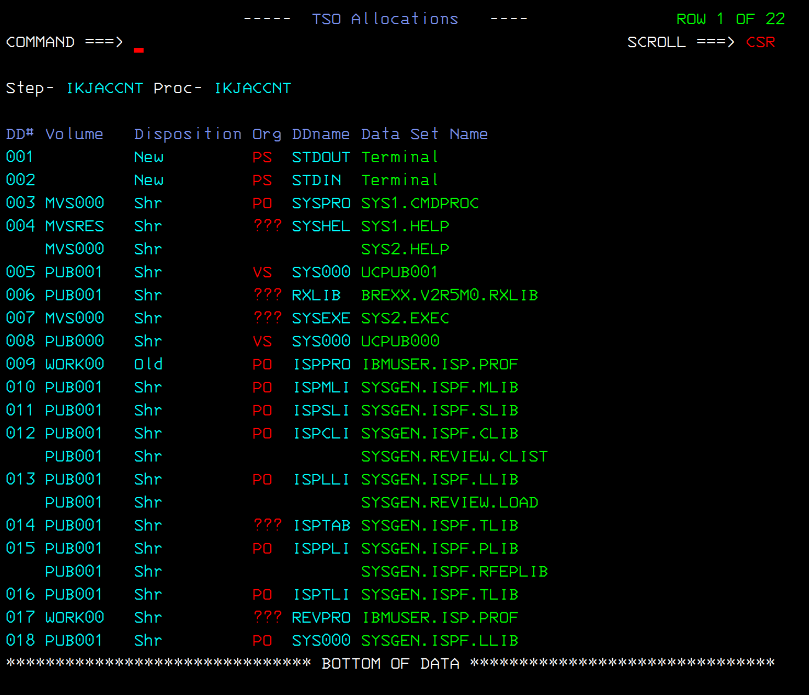
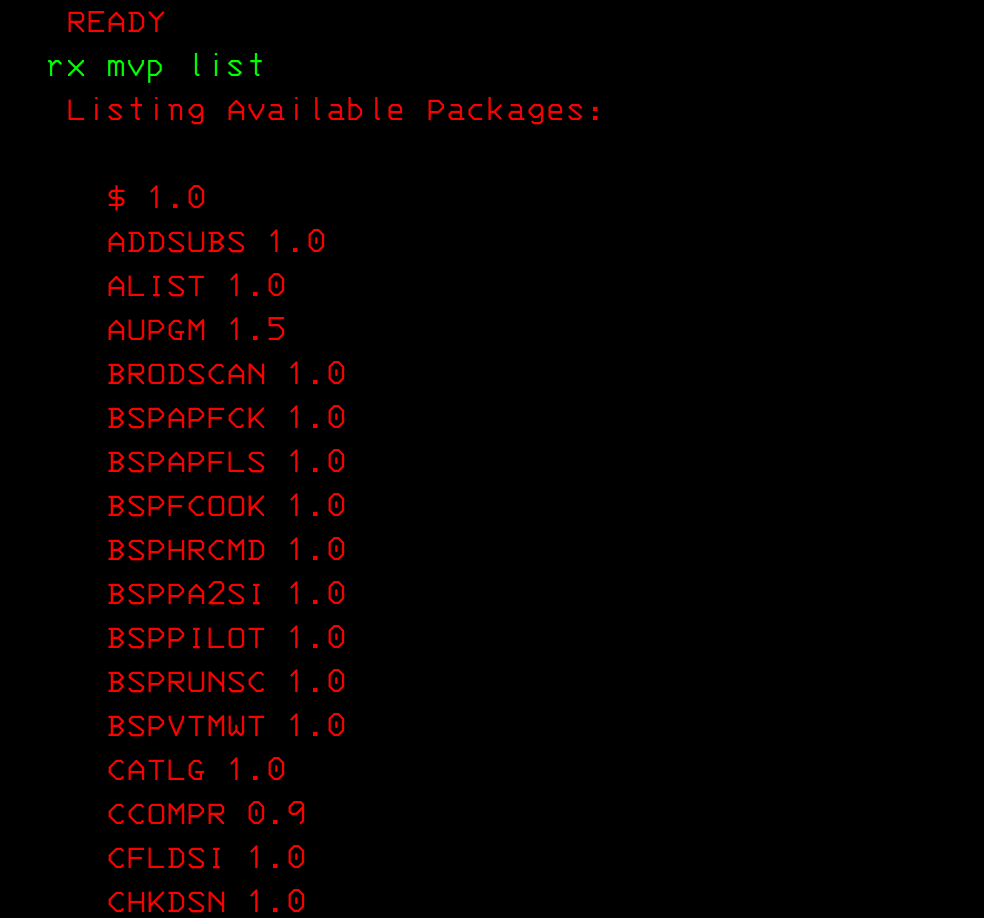

# MVS Community Edition Sysgen



To use this version of MVS you can download the current release and run `bash start_mvs.sh`.

Requirements:

- Linux
- hercules SDL >= 4.5 (see below how to build SDL Hercules)
- python3
- git
- tar

The following is also recommended:

- c3270/x3270
- ncat

## Running

Go to https://github.com/MVS-sysgen/sysgen/releases and download the latest release.
Tagged versions are official releases, latest is automatically built after every
commit. The latest version has all the recent changes and might be unstable. 

## Docker

If you have docker you can run MVS/CE in a docker container. 

From the command line run:

```
docker run -d \
  --name=mvsce \
  -e HUSER=docker \
  -e HPASS=docker \
  -p 3270:3270 \
  -p 3223:3223 \
  -p 3271:3271 \
  -p 3505:3505 \
  -p 3506:3506 \
  -p 8888:8888 \
  -p 2121:2121 \
  -p 3221:3221 \
  -p 22000-22200:22000-22200 \
  -p 8080:8080 \
  -v /opt/docker/mvsce:/config \
  -v /opt/docker/mvsce/printers:/printers \
  -v /opt/docker/mvsce/punchcards:/punchcards \
  -v /opt/docker/mvsce/logs:/logs \
  -v /opt/docker/mvsce/dasd:/dasd \
  -v /opt/docker/mvsce/certs:/certs \
  --restart unless-stopped \
  mainframed767/mvsce:latest
```

Make sure the directories are correct for your docker volumes and hit enter,
this will download the latest MVS/CE release and deploy it. You can then
connect with your 3270 client on port 3270 (or port 3223 for encrypted
communication).

| Port | Service |
|---|---|
| 3270 | TN3270 |
| 3223 | TN3270 over TLS |
| 3271 | TN3270 over WebSocket |
| 3505 / 3506 | card readers (ASCII / EBCDIC) |
| 8888 | Hercules web console (`HUSER`/`HPASS`) |
| 2121 | FTPD (after `/S FTPD`) |
| 3221 | FTPD over TLS |
| 22000-22200 | FTPD passive data connections |
| 8080 | HTTPD and mvsMF under `/zosmf` (after `/S UFSD` and `/S HTTPD`) |

UFSD, HTTPD and FTPD are not started at IPL; start them from the console
or SDSF (`/S UFSD`, `/S HTTPD`, `/S FTPD`). Passive FTP with EPSV (most
clients) works as is. A client that uses plain PASV is sent the container's
own address; for those set `PASVADR` in `SYS2.PARMLIB(FTPDPRM0)` to the
Docker host's address.

More details are available here: https://hub.docker.com/r/mainframed767/mvsce

To build the container yourself, use the Dockerfiles in [Docker/](Docker/):
`docker build -f Docker/Dockerfile.local -t mvsce:local .` runs the whole
sysgen in the build and needs no release download.

## Screenshots

**Wally ISPF with MVS/CE theme**











**MVP**

 


# Building and Installing Hercules

Please use https://github.com/wrljet/hercules-helper to build hercules

## Sysgen

Currently only Debian/Ubuntu based systems are supported. If your system requires a password for sudo commands you may get prompted for your password to install needed software.

:warning: **DO NOT** run this script as root, there is a bug in hercules which will cause it to eat up all your machine resources :warning:

*depending on your system this could take upward of two hours.* If you want to follow along you can use `tail -F sysgen.log`.

Running MVS/CE sysgen builds a modified Jay Moseley sysgen of MVS 3.8J and
installs the software below in these steps (`./sysgen.py -l` lists them with
their substeps; each step writes a backup that the next one restores):

| Step | What it does |
|---|---|
| `step_01_build_starter` .. `step_04_system_generation` | Jay Moseley's starter system, SMP 4.44 + ESY1400 (SMP 04.48), distribution libraries and the system generation |
| `step_05_usermods` | the usermods in `usermods/`, all on one IPL of the starter system, one job after the other (one substep each; `--substep` restarts from the start of step 5, see `USERMOD_IPL_POINTS`), including ZP60038 at REWORK 20261106 for ISPF `VPUT`/`VGET` from REXX |
| `step_06_fdz1d02` | FDZ1D02 |
| `step_07_customization` | MVS000, DYNPROC, date, TSO users, then `brexx`: the TRANSMIT/RECEIVE commands of NJE38 (IPL with CLPA), BREXX/370 with SMP, usermod MS00100 and `BREXX.LINKLIB` in the link list |
| `step_08_rakf` | RAKF from its git tag, with the users in `users.conf` and the profiles in `profiles.conf` |
| `step_09_mvp` | MVP, the package manager |
| `step_10_extras` | usermods ZP60041/42/43 and ZMG0001 (BREXX/370 TSO integration; PTF UY16532 is accepted first) |
| `step_11_nje38` | NJE38 with MVP |
| `step_12_ispf` | Wally ISPF and RFE with MVP |
| `step_12a_mvslovers` | UFSD, FTPD, HTTPD and mvsMF with SMP, their site configuration and UFS disks, and a start/stop smoke test |
| `step_12b_sdsf` | SDSF with SMP, APF and link list entries, ISPF/TSO setup (IPL with CLPA) |
| `step_13_customize` | `jcl/customize.jcl` (OPNTERSE with MVP by default) |
| `step_14_cleanup` | `jcl/finalize.jcl` (COMMND00, the SHUTDOWN/SHUTFAST commands), then the folder `MVSCE` with the finished system |

To build MVS/CE use `sysgen.py`. This python script can take many arguments:

- `--version` This sets the version number displayed at logon and in `SYS1.PARMLIB(RELEASE)`
- `--users` By default sysgen will use the users in the file `users.conf`, you can supply your own with this argument
- `--profiles` By default sysgen will use the RAKF profiles in the file `profiles.conf`, you can supply your own with this argument
- `--username`/`--password` These arguments add an admin user with the username/password supplied
- `--timeout` Sometimes hercules will end up in a state which can deadlock sysgen, to prevent it from running forever a timeout has been set. The defaul it thirty minutes. Use this argument to change it to something shorter/longer, in seconds.
- `--hercules` Path to a specific hercules binary
- `--no-compress` By default this script will compress DASD files, that is not needed on some file systems, this will disable compression
- `--keep-backup` This script backups after every step then removes the backups when completed, if you'd like to keep the backup DASD images use this flag
- `--keep-temp` This script generates multiple temp files during sysgen and removes the folder when completed, if you wish to keep the temp files pass this flag

Assuming you have all the prerequisites installed (git, tar, python3 and
 hercules) the recommended command used to build sysgen is:

```bash
until ./sysgen.py --CONTINUE; do echo "Failed, rerunning"; done
```

This until loop will run until sysgen is complete. This is due to multiple
bugs in hercules which may cause it to fail and which is typically fixed
by rerunning the failed step.

### Automation control options

The arguments below are for more granular control of where to start sysgen from. These can be used if a step has failed of if you make changes to a step and start the install from that step instead of starting over. Some steps are atomic, some have multiple sub steps. With the arguments below you can continue/restart from either.

- `-l` or  `--list` This will list all available steps and substeps.
- `--step` Restart sysgen from this step. The install will continue from here.
- `--substep` Restart sysgen from a steps substep.

- `-C` or `--CONTINUE` If sysgen fails for any reason a file (`.step`) is created prior to exit, this argument reads that file and continues building MVS/CE from where it left off. This superscedes the `--step` and `--substep` arguments.

:warning: By default sysgen will remove the temp and backup folders. If you're doing development work you can use the `--keep-backup` and `--keep-temp` arguments to keep those folders after systen completes allowing you to restart sysgen at any point. 

## Software installed with SMP

The mvslovers stack is installed with SMP from pinned releases. Versions and
sha256 sums are in `mvslovers.conf`; `./sysgen.py --update-mvslovers [p1,p2]`
moves the pins to the newest releases (review the diff and commit it), and
`--mvslovers-dist DIR` builds with dists of your own instead.

| Product | Version | FMID / SYSMOD | SMP status | Libraries |
|---|---|---|---|---|
| [BREXX/370](https://github.com/mvslovers/brexx370) | 3.1.0 | `TBRX310` | REC APP ACC | `BREXX.LINKLIB` (link list, not APF), `BREXX.RXLIB` (also as alias `BREXX.CURRENT.RXLIB`), `BREXX.SAMPLIB`, `BREXX.PROCLIB` |
| MS00100 (link list for BREXX) | | `MS00100` | REC APP | |
| ZMG0001 (BREXX/370 TSO integration) | 3.1.0 | `ZMG0001` | REC APP (never accepted) | `USERMOD.ZMG0001` kept on PUB000 |
| [RAKF](https://github.com/mvslovers/RAKF) | v2.0.0 | `TRKF200` | REC APP ACC | `SYS1.SECURE.CNTL` (users, profiles) |
| [UFSD](https://github.com/mvslovers/ufsd) | 1.5.2 | `TUFS152` | REC APP ACC | `UFSD.*` |
| [FTPD](https://github.com/mvslovers/ftpd) | 1.3.4 | `TFTP134` | REC APP ACC | `FTPD.*` |
| [HTTPD](https://github.com/mvslovers/httpd) | 4.5.1 | `THTP451` | REC APP ACC | `HTTPD.*` |
| [mvsMF](https://github.com/mvslovers/mvsmf) | 1.4.1 | `TZMF141` | REC APP ACC | `MVSMF.*` (in the HTTPD STEPLIB) |
| [SDSF](https://github.com/mvslovers/sdsf) | 1.2.0 | `TISF120` | REC APP ACC | `ISF.LINKLIB` (APF, link list), `ISF.ISFPLIB`, `ISF.ISFCLST` |

What this means on the running system:

- **BREXX/370** runs unauthorized. `ADDRESS COMMAND 'CP ...'` needs RAKF
  `FACILITY DIAG8CMD` READ, and `CONSOLE`, `MTT` and `PRIVILEGE` need
  `FACILITY SVC244` READ (group ADMIN has both). With ZMG0001, TSO `EXEC`
  and `%name` run REXX execs through BREXX/370 (members of
  `SYSUEXEC`/`SYSEXEC`, or with `/* REXX */` on line 1).
- **UFSD, FTPD, HTTPD, mvsMF** run authorized through RAKF's SVC 244 (no APF
  entries) and are **not started** at IPL: `/S UFSD`, then `/S HTTPD` (port
  8080, mvsMF under `/zosmf`) and `/S FTPD` (port 2121). Procedures are in
  `SYS2.PROCLIB`, configuration in `SYS2.PARMLIB` (`UFSDPRM0`, `FTPDPRM0`,
  `HTTPPRM0`). UFS disks: `UFSD.ROOT` for `/`, `HTTPD.WEBROOT.UFS` for `/www`,
  `UFSD.SCRATCH` for `/tmp` and `<USER>.UFSHOME` for `/u/<user>` per
  `users.conf` user. They are no longer MVP packages.
- **SDSF**: `TSO SDSF` from ISPF. RAKF `FACILITY SDSF.OPER` (ADMIN UPDATE)
  allows LOG, PR, INIT and `/` commands; `JESSPOOL` other users' jobs.

### Checking what is installed

SMP knows every product and usermod. As a RAKF admin:

```jcl
//SMPLIST  JOB (SMP),'LIST',CLASS=A,MSGCLASS=A
//LIST     EXEC SMPAPP,WORK='SYSALLDA'
//SMPCNTL  DD  *
 LIST CDS SYSMOD(TBRX310 MS00100 ZMG0001 TRKF200
     TUFS152 TFTP134 THTP451 TZMF141 TISF120) .
 LIST ACDS SYSMOD(TBRX310 TRKF200 TUFS152 TFTP134
     THTP451 TZMF141 TISF120) .
/*
```

Each FMID shows `STATUS = REC APP ACC` in the CDS, ZMG0001 and MS00100
`REC APP`. Never trust the condition code alone: a `NOT SEL` APPLY ends RC 0
with nothing copied.

### Upgrading a product

The products are normal SMP functions, so a new release goes on the
running system the way its install guide describes. In short:

1. **UFSD, FTPD, HTTPD, mvsMF, SDSF, BREXX/370** (dist releases): download the
   new `<product>-<version>-dist.tar.gz`, upload its `.xmit` files (FTP binary,
   or the card reader), and run its **inst** job (RECEIVE + APPLY), then its
   **accept** job if the release has one (older ufsd/httpd releases accept in
   the inst job). Change the `CHANGE.ME` names to your uploaded data sets.
   Do not run the alloc job again: the libraries exist. Stop the server
   first (`/P HTTPD`, ...) and check with `LIST CDS SYSMOD(<new FMID>)`.
   The site configuration (`SYS2.PROCLIB`, `SYS2.PARMLIB`) is a copy and is
   not touched; compare it with the new `*.SAMPLIB` members.
2. **ZMG0001** (with a new BREXX/370 release): remove the old one first with
   `ZMG01RS` from the old `USERMOD.ZMG0001` (RESTORE; works because
   UY16532 is accepted; drop its optional `COPY` step, sysgen makes no
   backup), then RECEIVE the new `ZMG0001.xmit` into `USERMOD.ZMG0001`
   and run its `$INSTALL` (RECEIVE, APPLY CHECK) and `ZMG01AP` (assemble,
   APPLY). Do not accept ZMG0001.
3. **RAKF**: follow the RAKF release notes; it ships its own install stream.

To build a new image with the new levels instead, bump the pins
(`--update-mvslovers`) and run sysgen.

## Customizing your build with customize.jcl

Near the end of sysgen (step 13, `step_13_customize`) the file `jcl/customize.jcl`
is submitted to the newly built system. At this point BREXX, RAKF, MVP, NJE38,
ISPF, the mvslovers stack and SDSF are already installed, so this jobstream is the place to add your own
customizations that you want baked in to the final system.

Note: `jcl/customize.jcl` must **not** contain a JOB card, sysgen.py generates one
automatically using a RAKF admin user (the commented out job card at the top of the
file shows what it will look like).

### Installing software with MVP

The most common use of `customize.jcl` is installing extra software using MVP, the
MVS/CE package manager. Each package is installed with one EXEC statement:

```jcl
//MVPINST EXEC MVP,INSTALL='RPF -D'
```

The `-D` flag enables debug output to the job log and MVS console, which is
recommended during sysgen so failures are easier to diagnose.

By default `customize.jcl` installs OPNTERSE (UFSD, FTPD, HTTPD and mvsMF are
installed with SMP in step 12a). To
install additional packages just add more `//MVPINST EXEC MVP,INSTALL='...'` lines,
one per package:

```jcl
//MVPINST EXEC MVP,INSTALL='OPNTERSE -D'
//MVPINST EXEC MVP,INSTALL='RPF -D'
```

To see what packages are available check the `MVP/packages` folder in this repo, or
see the MVP repository: https://github.com/MVS-sysgen/MVP

You are not limited to MVP installs: any JCL steps you want (copying members,
allocating datasets, applying local mods, etc.) can be added to this jobstream.

:warning: sysgen expects every step in `customize.jcl` to end with a condition code
of 0000. If any step fails (for example, a typo in a package name) sysgen will stop
at step 13, and you can fix the JCL and rerun with `-C` (or `--step step_13_customize`).

## Usernames/Passwords

**RAKF**/**TSO**

| Username  | Password |
|:---------:|:--------:|
| IBMUSER   | SYS1     |
| MVSCE01   | CUL8TR   |
| MVSCE02   | PASS4U   |

:warning: *IBMUSER* and *MVSCE01* are RAKF and TSO admins.

You can add a admin user using the `--username` flag. To add more users edit the `users.conf` file.

## Shutting down

From TSO, as a RAKF admin (`FACILITY SVC244` READ): `SHUTDOWN` (warnings
every minute, shutdown after 5 minutes) or `SHUTFAST` (10 seconds). They
start the procedure `SYS2.PROCLIB(SHUTDOWN)` as a started task, the same as
`/S SHUTDOWN` or `/S SHUTDOWN,TYPE='SHUTFAST'` on the console, and return at
once. The procedure runs the execs of the same names in `SYS2.STCEXEC`.
`SYS2.JCLLIB(SHUTDOWN)` and `(SHUTFAST)` do the same as a batch job; add
`USER=`/`PASSWORD=` of an admin to the job card, because a job without a
user gets no `CONSOLE` or `CP` command from BREXX/370.

## Changes From Jay Moseley Sysgen

* Added multiple usermods
* Added RAKF, BREXX, RFE, and ISPF
* Installs BREXX/370, RAKF, UFSD, FTPD, HTTPD, mvsMF and SDSF with SMP
* Installed usermod `DYNPROC` which allows for dynamic proclibs
* Seperated out usermods to their own JCL for better automation control
* Added `S NET` and changed JES2 startup parms in `sys1.parmlib(COMMND00)`
* Automated startup using HAO hercules
* Adds version to NETSOL
* Added `SYS1.PARMLIB(RELEASE)` which contains release information

And many more. See the branch `original` which tracked changes to the original sysgen and the git log
to see the hundred of other changes since the initial release.

## Info

This repo is heavily based on Jay Moseley sysgen. His writeup is a wonderful resource and you should read the site here: http://www.jaymoseley.com/hercules/installMVS/iMVSintroV7.htm

A lot of the information contained on this repo is directly from his sysgen walkthrough.

There are lots of files and folders. Each folder has a readme explaining from a high level what each file does.

## System Setup Information:

From: http://www.jaymoseley.com/hercules/installMVS/iCUSTv7.htm

Much of the operation of MVS is controlled by JES2 and the parameters that affect JES2 are contained in the member JES2PM00 in SYS1.PARMLIB.  The three main functions are job entry (readers), job execution (job classes), and output (printers and punches).

**Card Readers**

There is one Hercules emulated card reader that is controlled by JES2 - the 2540R at address `x'00c'`. There are other card readers generated into the system and one of those is also defined in the Hercules configuration file - the 2540R at address `x'01c'`.

**Printers**

There are two emulated printers controlled by JES2 - the 1403 at address `x'00e'` and the 3211 at address `x'00f'`. The 1403 printer defined at address `x'015'` is a special case as it defined as, and dedicated to the hardcopy log; it is not controlled by JES2. There are other printers generated into the system, but they are not defined in the configuration file; they are simply 'extra' printers.

**Card Punch**

There is one emulated card punch that is controlled by JES2 - the 2540P at address `x'00d'`.  There are other card punches generated into the system and one of those is also definied in the Hercules configuration file - the 2540P at address `x'01d'`.

**CLASS**

The `CLASS=` parameter on the JOB card determines the class that the job is intended to be run in.

There are six initiators defined to JES2, three are not active when MVS is IPLed, but three of them are automatically started.  The initiators select a job for execution when the `CLASS=` parameter on the JOB card matches one of the CLASSES the initiator is set to process.  Currently the initiators are set to process these classes (listed in order by highest priority first):

| Initiator 1 | Initiator 2 | Initiator 3 | Initiator 4 (not started) | Initiator 5 (not started) | Initiator 6 (not started) |
|:-----------:|:-----------:|:-----------:|:-------------------------:|:-------------------------:|:-------------------------:|
| A           |     B,A     |      S      |         D,C,B,A           |  E,C,B,A                  |   F,E,C,B,A               |


Class **S** is intended for use for System Programming tasks, so some of the control has been loosened on that class, which is why you don't have to 'approve' embedded console commands.  It is not a good idea to simply use S for all of your jobs, however, as there are good reasons for those controls being in place.

The two printers controlled by JES2 are set to select non-held printer output in class **A** (the 1403 at x'00e') and class M (the 3211 at x'00f').

The card punch controlled by JES2 is set to select non-held punch output in class **B**.

Some of the parameters for JES2 may be changed from the MVS console and the changes will only remain in effect until the next IPL.  Some of the parameters must be changed by altering the JES2PM00 member in SYS1.PARMLIB, then stopping and restarting JES2.

